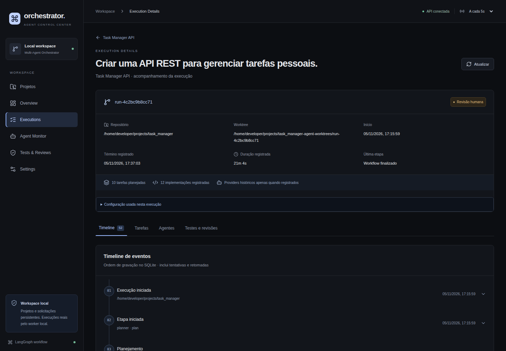
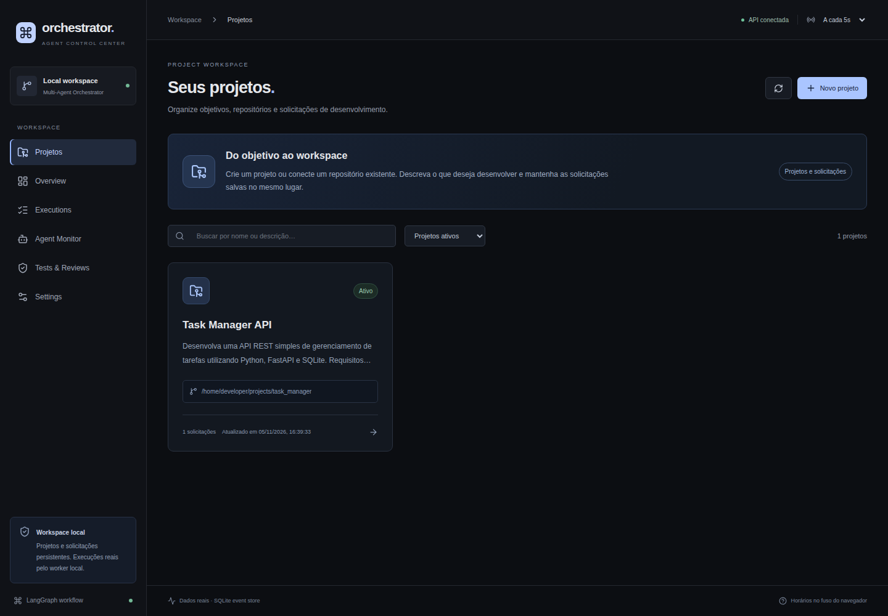
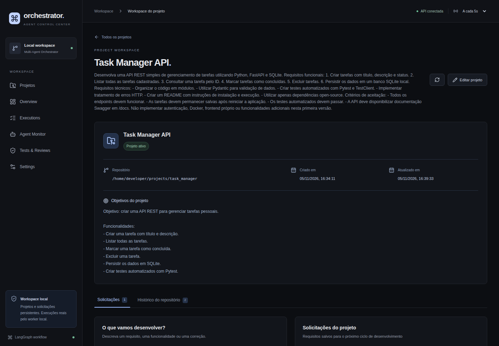
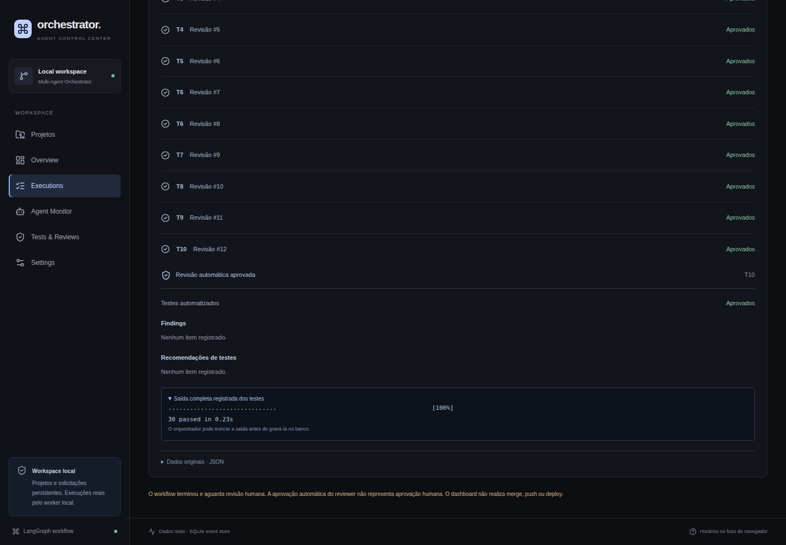
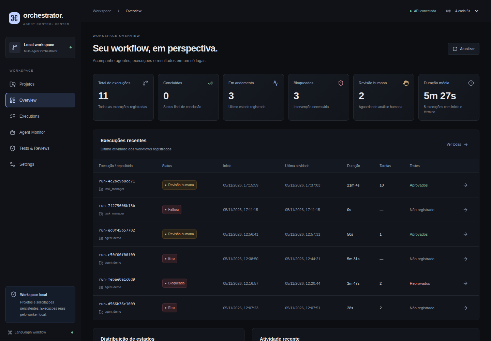
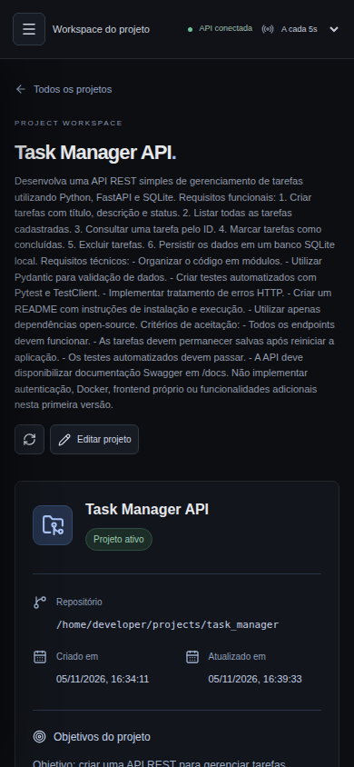
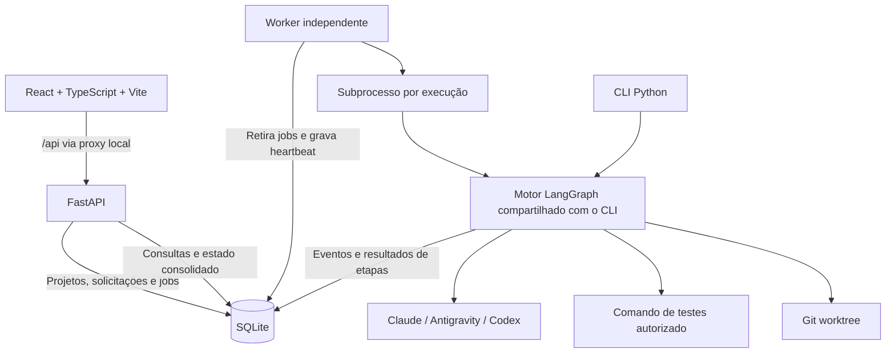

# Multi-Agent Coding Orchestrator

**Uma plataforma local para transformar requisitos em execuções de desenvolvimento com agentes de IA, acompanhadas pelo navegador.**

O Multi-Agent Coding Orchestrator reúne projetos, solicitações em linguagem natural, planejamento, implementação, testes automatizados e revisão independente em um único workspace. A interface React permite iniciar uma solicitação existente e acompanhar o workflow real do LangGraph, enquanto o backend FastAPI, o worker e o SQLite mantêm o histórico e o estado da execução.

O código é produzido em uma **Git worktree separada do repositório de origem**. Ao concluir o workflow, as alterações ficam disponíveis para inspeção e revisão humana. A plataforma não realiza merge, push ou deploy automaticamente.



[Funcionalidades](#funcionalidades) · [Interface](#interface) · [Arquitetura](#arquitetura) · [Instalação](#instalação) · [Executar localmente](#executar-localmente) · [Configuração](#configuração) · [Testes](#testes-e-qualidade) · [Limitações](#limitações-atuais)

## O que a plataforma resolve

Operar vários agentes por comandos isolados dificulta manter o contexto do projeto, saber qual tarefa está sendo executada, inspecionar resultados e reconstruir o que aconteceu quando uma ferramenta falha.

A plataforma organiza esse trabalho em três níveis:

- **Projeto:** nome, descrição, objetivos e associação com um repositório Git local.
- **Solicitação:** o requisito que o usuário deseja desenvolver, escrito e persistido em linguagem natural.
- **Execução:** uma tentativa concreta de atender à solicitação, com configuração dos agentes, worktree, eventos, testes, revisões e resultado próprios.

Uma solicitação pode ter várias execuções ao longo do tempo. Repetir uma chamada HTTP por falha de conexão não precisa criar outro run: o início usa uma chave de idempotência. Iniciar intencionalmente uma nova execução exige uma nova confirmação.

O foco atual é **desenvolvimento local supervisionado**, com rastreabilidade e ações reais. A plataforma utiliza os CLIs já instalados e autenticados no ambiente do operador; não oferece execução hospedada de agentes nem uma conta central de providers.

## Funcionalidades

| Área | Disponível hoje |
| --- | --- |
| Projetos | Cadastro, busca, edição, arquivamento e reativação de projetos nomeados |
| Repositórios | Associação de repositórios existentes e criação confirmada de diretório, Git, README e commit inicial local |
| Requisitos | Solicitações persistidas em linguagem natural, sem exigir arquivos Markdown escritos manualmente |
| Início pelo navegador | Ação **Iniciar execução** por solicitação, com confirmação dos requisitos e da configuração |
| Execution Manager | Fila SQLite, vínculo projeto–solicitação–run e configuração congelada por execução |
| Worker | Processo independente da API, com supervisão de um subprocesso por workflow |
| Concorrência | Reserva persistente por identidade Git compartilhada e lock advisory também utilizado pelo CLI |
| Planejamento | Decomposição em tarefas ordenadas, instruções e critérios de aceitação |
| Implementação e QA | Ciclo de implementação, testes, revisão independente e novas tentativas quando necessário |
| Observabilidade | Timeline, etapa registrada, plano, tentativas, testes, findings, erros e caminho da worktree |
| Persistência | Projetos, solicitações, lifecycle, resultados, eventos e auditoria no SQLite |
| Interface | Dark mode, navegação por projetos, filtros, paginação, estados de erro e layout responsivo |
| CLI | Comandos para executar escopos, consultar eventos e retomar conservadoramente runs legados |

**A aprovação automática do Reviewer não é aprovação humana.** O estado `ready_for_human_review` informa que o motor concluiu o workflow e entregou o resultado para análise do operador.

## Interface

As capturas abaixo são do frontend atual, consultando uma cópia de dados registrados no SQLite. Caminhos de usuário foram anonimizados somente nessa cópia para documentação. As imagens não são mockups e sua captura não iniciou agentes nem modificou o banco original.

### Projetos e workspace

A página inicial organiza os projetos por nome. Cada workspace reúne objetivos, solicitações e histórico, preservando os IDs técnicos para as áreas de detalhe.





### Testes e revisões

Os resultados são apresentados como evidências estruturadas: aprovação ou reprovação da revisão, resultado dos testes, findings, recomendações e saída registrada. Os payloads originais continuam disponíveis para diagnóstico.



<details>
<summary>Ver Overview e interface mobile</summary>

O Overview apresenta contagens reais, distribuição de estados, duração média dos intervalos registrados e atividade recente. A interface mobile mantém acesso à navegação e ao workspace.





</details>

## Como funciona o workflow


1. O usuário seleciona uma solicitação já cadastrada no projeto.
2. O backend verifica vínculo, autorização dos diretórios, Git, `HEAD`, limpeza do repositório, ferramentas locais, comando de testes e presença do worker.
3. A confirmação aceita a configuração exibida e registra um job com Run ID e chave de idempotência.
4. O worker retira o job da fila e inicia um subprocesso com a configuração daquela execução.
5. O motor cria uma worktree e o Planner gera as tarefas do escopo.
6. O Implementer modifica os arquivos da tarefa atual.
7. O orquestrador executa os testes configurados; o Reviewer analisa a implementação e os resultados.
8. O grafo avança, pede outra tentativa ou bloqueia a execução conforme o resultado e o limite de tentativas.
9. Ao terminar todas as tarefas, o resultado fica em `ready_for_human_review`.

Falhas de preparação, de ferramentas ou de execução são persistidas. A existência de um evento `finished` ou de um processo encerrado, isoladamente, não é tratada como sucesso.

### Papéis e integrações dos agentes

| Papel | Integrações existentes | Configuração de modelo |
| --- | --- | --- |
| Planner | Claude ou Antigravity | Modelo explícito no caminho Antigravity; padrão do CLI no caminho Claude |
| Implementer | Claude ou Antigravity | Modelo explícito no caminho Antigravity; padrão do CLI no caminho Claude |
| Reviewer | Codex | Padrão do CLI na integração atual |
| Coordenador | LangGraph | Controla sequência, decisões condicionais e tentativas |

O Planner configurado com Claude possui fallback para Antigravity quando a integração reconhece determinados erros de limite de uso. Esse fallback não é aplicado livremente a qualquer erro nem ao Implementer.

Os padrões do motor são **Claude para Planner e Implementer**, com Codex no Reviewer. Os exemplos deste README selecionam Antigravity para implementação; essa escolha deve corresponder às ferramentas autenticadas no seu ambiente.

Configuração do servidor e identidade histórica do agente são informações diferentes. Eventos antigos podem não registrar o provider ou o modelo utilizado. A interface preserva essa ausência de informação, sem atribuir retrospectivamente um provider a partir da configuração atual.

## Arquitetura



### Componentes

- **Frontend:** React, TypeScript, Vite, React Router, TanStack Query, Tailwind CSS, componentes locais no padrão shadcn/ui e ícones Lucide.
- **API:** FastAPI com validação Pydantic, endpoints locais de gerenciamento e leitura consolidada de eventos.
- **Execution Manager:** persistência da intenção de execução, cópia da configuração e dos requisitos, reserva do repositório e leitura do lifecycle.
- **Worker:** fila FIFO persistente, heartbeat e supervisão dos subprocessos, sem executar o workflow dentro de uma requisição HTTP.
- **Motor:** LangGraph, integração com CLIs, testes automatizados, revisão e ciclo de tentativas.
- **Armazenamento:** SQLite para catálogo, solicitações, fila, estados, eventos e auditoria; Git para worktrees e branches por execução.

A API pode ser reiniciada sem encerrar o worker. O worker precisa ser iniciado separadamente e usa o mesmo banco da API. Nesta implementação, há **um workflow por vez por worker/banco**, embora solicitações de repositórios distintos possam aguardar na fila.

## Pré-requisitos

| Requisito | Observação |
| --- | --- |
| Linux | A supervisão utiliza `/proc`, grupos de processos e locks de arquivo; criação controlada de projetos também utiliza recursos Linux |
| Python 3.9+ | Ambiente local validado com Python 3.9; dependências em `requirements.txt` |
| Node.js | Linha 22 a partir de 22.13 ou linha 24; ambiente local validado com Node 22.18, compatível com as ferramentas atuais de build e testes |
| npm | Instalação reproduzível pelo `frontend/package-lock.json` |
| Git | Necessário para registrar repositórios, criar worktrees e preparar o código para revisão |
| CLIs dos agentes | `claude` e/ou `agy` conforme os papéis selecionados; `codex` para o Reviewer; `agy` também é necessário se o fallback do Planner for utilizado |
| Autenticação dos providers | Feita previamente nos próprios CLIs, fora da interface web |
| Dependências do projeto alvo | Precisam estar disponíveis no ambiente em que seu comando de testes será executado |

A presença de um executável no PATH não comprova autenticação nem quota disponível. Chamadas a agentes reais podem consumir os limites ou créditos dos respectivos providers. O orquestrador não instala automaticamente ferramentas ou dependências do projeto alvo.

## Instalação

```bash
git clone https://github.com/felipesembay/multi_agent-coding-orchestrator.git
cd multi_agent-coding-orchestrator

python -m venv .venv
source .venv/bin/activate
python -m pip install -r requirements.txt

npm --prefix frontend ci
```

Se o repositório já está no seu computador, comece pela pasta existente e preserve os projetos e o banco de dados que já utiliza.

## Executar localmente

A operação pelo navegador utiliza **três processos**: API, worker e frontend.

### 1. Configure um ambiente compartilhado

Na raiz do repositório, crie um arquivo local `.env` com o conteúdo abaixo, ajustando as escolhas ao seu ambiente:

```bash
export ORCH_ALLOWED_ROOTS="$HOME/projects"
export ORCH_TEST_COMMAND="python -m pytest -q"
export ORCH_PLANNER=claude
export ORCH_IMPLEMENTER=antigravity

# Opcional: selecione os modelos Antigravity que utiliza.
# export ORCH_PLANNER_MODEL="seu-modelo-configurado"
# export ORCH_IMPLEMENTER_MODEL="seu-modelo-configurado"

# Opcional: use um banco específico, igual nos dois processos.
# export ORCH_DB="$HOME/.local/state/multi-agent-orchestrator/events.db"
```

Esse arquivo é ignorado pelo Git. **Ele não é carregado automaticamente:** os comandos abaixo fazem `source .env` explicitamente. Use somente um arquivo local confiável, com sintaxe de shell. O exemplo guarda configuração operacional, não credenciais dos providers.

Crie a pasta autorizada caso ainda não exista:

```bash
mkdir -p "$HOME/projects"
```

**Um `export` vale apenas para o terminal atual e os processos iniciados por ele.** API e worker iniciados em terminais diferentes precisam carregar a configuração separadamente. Essa etapa evita que a API aceite uma execução e o worker depois a recuse por falta de `ORCH_ALLOWED_ROOTS`.

### 2. Terminal da API

A partir da raiz do repositório:

```bash
source .venv/bin/activate
source .env
python -m uvicorn orchestrator.api:app --host 127.0.0.1 --port 8765
```

- Saúde da API: <http://127.0.0.1:8765/health>.
- Documentação interativa dos endpoints: <http://127.0.0.1:8765/docs>.

### 3. Terminal do worker

Em outro terminal, também na raiz do repositório:

```bash
source .venv/bin/activate
source .env
python -m orchestrator.worker
```

O worker deve informar que está pronto e aguardando solicitações persistidas. Iniciá-lo pode processar jobs que já tenham sido confirmados anteriormente e permaneçam em `queued`.

Não existe necessidade de abrir outro worker a cada execução. Apenas um worker por banco é permitido; jobs subsequentes utilizam a mesma fila.

### 4. Terminal do frontend

```bash
cd frontend
npm run dev -- --host 127.0.0.1 --port 5173 --strictPort
```

Abra <http://127.0.0.1:5173>. A API fica em `127.0.0.1:8765`, acessada pelo frontend através do proxy `/api` do Vite.

Reinicie API e worker após alterações de código ou de configuração. O hot reload do Vite atualiza a interface durante o desenvolvimento, mas não atualiza processos Python que já estavam em execução.

### Portas e origens personalizadas

- Para apontar o Vite a outra API, configure `ORCH_API_TARGET` no processo do frontend.
- Se a origem do frontend mudar, ajuste `ORCH_ALLOWED_ORIGINS` no processo da API.
- Preserve o mesmo `ORCH_DB`, as autorizações de diretórios e a política de testes na API e no worker.
- O proxy é de desenvolvimento. Uma distribuição de `frontend/dist/` precisa de reverse proxy para `/api` e fallback das rotas React para `index.html`; `vite preview` sozinho não substitui essa configuração.

## Uso pelo navegador

### Criar ou conectar um projeto

1. Na página **Projetos**, clique em **Novo projeto**.
2. Escolha registrar um repositório existente ou criar um projeto novo.
3. Informe nome, descrição, objetivos e caminho absoluto autorizado.
4. Clique em **Revisar projeto** para validar o cadastro e inspecionar as operações previstas.
5. Marque a confirmação e conclua o cadastro.

O cadastro de um repositório existente não modifica seus arquivos ou commits. Um projeto novo cria o diretório final, inicializa Git e grava um README e um commit inicial local, conforme a confirmação apresentada.

Para criação, o diretório pai precisa existir e o diretório final não pode existir. O backend não sobrescreve diretórios existentes. Repositórios registrados podem ainda não ter commit, mas a execução do motor exigirá um `HEAD` válido e uma árvore de trabalho limpa.

### Registrar e executar uma solicitação

1. Abra o workspace do projeto.
2. Registre título e requisitos em linguagem natural. Por exemplo: “Crie uma API REST para gerenciar tarefas pessoais, com testes e documentação”.
3. Para uma solicitação já registrada, reutilize o mesmo item; não recrie o projeto ou o requisito para executar.
4. Clique em **Iniciar execução**.
5. Confira projeto, repositório, requisitos, agentes, modelos conhecidos, fallback, comando de testes e disponibilidade do worker.
6. Marque a autorização e clique em **Confirmar e iniciar**.
7. Acompanhe a execução pela página aberta automaticamente.

O backend responde `202 Accepted` após persistir o job. Isso confirma o enfileiramento, não a conclusão do desenvolvimento. Uma falha posterior de preparação ou execução aparece no estado e no histórico do run.

### Acompanhar e revisar o resultado

A página de execução apresenta a etapa registrada, plano de trabalho, critérios de aceitação, eventos em ordem de gravação, tentativas, testes, findings, configuração utilizada, erros e caminho da worktree.

Enquanto um run gerenciado estiver em `queued` ou `running`, a página consulta a API a cada três segundos. Os dados continuam disponíveis após recarregar a página ou voltar em outro dia. Se a atividade do supervisor não estiver confirmada, a interface informa essa condição.

Ao receber `ready_for_human_review`, inspecione o código na worktree e avalie as evidências antes de integrar alterações manualmente. A interface atual não registra aprovação humana de diffs nem realiza integração Git.

Projetos podem ser arquivados e reativados. Arquivar preserva os dados e bloqueia novas solicitações e inícios de execução; não equivale a cancelar um workflow já em andamento.

## Configuração

As variáveis são lidas no ambiente dos processos. Configurações sensíveis e autenticação dos CLIs não são administradas pelo frontend.

| Variável | Padrão | Uso |
| --- | --- | --- |
| `ORCH_DB` | `~/.local/state/multi-agent-orchestrator/events.db` | Banco de projetos, solicitações, runs, eventos e auditoria |
| `ORCH_ALLOWED_ROOTS` | Sem diretórios autorizados | Raízes permitidas para cadastro e execução; no Linux, múltiplas raízes usam `:` |
| `ORCH_ALLOWED_ORIGINS` | Origens HTTP locais nas portas 5173 e 8765, com `localhost` ou `127.0.0.1` | Origens aceitas nas operações protegidas; múltiplas origens usam vírgulas |
| `ORCH_PLANNER` | `claude` | Provider do Planner: `claude` ou `antigravity` |
| `ORCH_IMPLEMENTER` | `claude` | Provider do Implementer: `claude` ou `antigravity` |
| `ORCH_PLANNER_MODEL` | `gemini-4-argon-medium` no caminho Antigravity | Modelo do Planner Antigravity ou do fallback do Planner Claude |
| `ORCH_IMPLEMENTER_MODEL` | `gemini-4-argon-medium` no caminho Antigravity | Modelo do Implementer Antigravity |
| `ORCH_ANTIGRAVITY_MODEL` | `gemini-4-argon-medium` | Padrão do helper Antigravity quando chamado sem modelo explícito; os papéis do workflow usam as variáveis específicas acima |
| `ORCH_TEST_COMMAND` | Vazio | Comando de testes executado na worktree; necessário para iniciar runs gerenciados e para aprovação do QA |
| `ORCH_ALLOWED_TEST_COMMANDS` | Perfis predefinidos | Allowlist JSON de listas exatas de argumentos de testes, aplicada aos runs gerenciados |
| `ORCH_WORKTREES` | Pasta irmã `<nome-do-repositório>-agent-worktrees` | Diretório-base das worktrees; precisa ser autorizado no fluxo gerenciado |
| `MAX_ATTEMPTS` | `3` | Limite de tentativas de implementação por tarefa |
| `AGENT_TIMEOUT` | `900` | Timeout das chamadas de agentes, em segundos |
| `TEST_TIMEOUT` | `300` | Timeout do comando de testes, em segundos |
| `ORCH_API_TARGET` | `http://127.0.0.1:8765` | Destino do proxy de desenvolvimento do Vite; configurado no processo do frontend |

O Reviewer é Codex na integração atual. Não há seletor genérico de provider ou modelo do Reviewer no navegador. Os nomes de modelo presentes nos padrões do código não constituem um catálogo de disponibilidade do provider: configure um modelo aceito pela sua instalação do CLI.

### Política de comandos de teste

Os perfis padrão autorizados para execuções gerenciadas são:

```text
python -m pytest -q
python3 -m pytest -q
pytest -q
npm test
npm test -- --run
npm run test -- --run
```

O comando precisa corresponder a um perfil permitido, ter executável disponível e ser executável a partir da worktree. Não são aceitos comandos arbitrários enviados pelo navegador.

Para utilizar um interpretador específico, configure um caminho absoluto e sua allowlist correspondente em ambos os processos Python:

```bash
export ORCH_TEST_COMMAND='/caminho/absoluto/python -m pytest -q'
export ORCH_ALLOWED_TEST_COMMANDS='[["/caminho/absoluto/python","-m","pytest","-q"]]'
```

Evite `.venv/bin/python` como executável relativo: o diretório corrente dos testes será a worktree, que pode não conter essa pasta. O ambiente virtual do orquestrador também não garante que todas as dependências do projeto alvo estejam instaladas.

### Diretórios e worktrees

Para um repositório em `$HOME/projects/task_manager`, o diretório padrão de worktrees será `$HOME/projects/task_manager-agent-worktrees`. Autorizar `$HOME/projects` cobre ambos.

É possível autorizar somente um repositório para cadastro, mas isso não autoriza automaticamente uma pasta irmã para worktrees. No fluxo gerenciado, configure uma base também autorizada ou adicione explicitamente sua raiz à política do servidor.

## Estados, persistência e recuperação

| Estado | Significado |
| --- | --- |
| `queued` | Solicitação confirmada e persistida, com reserva do repositório, aguardando o worker |
| `running` | Subprocesso iniciado pelo worker; inclui preparação da worktree e execução do grafo |
| `ready_for_human_review` | Motor concluiu as tarefas e o QA; resultado disponível para revisão humana |
| `blocked` | Motor atingiu o limite de tentativas sem aprovação da tarefa |
| `failed` | Validação no despacho, inicialização, supervisão ou workflow falhou |
| `interrupted` | Processo interrompido ou reconciliado após reinício do worker |

`queued`, `running`, `failed` e `interrupted` descrevem o lifecycle do gerenciador. `ready_for_human_review` e `blocked` refletem resultados do motor. Runs legados sem informação suficiente podem aparecer com estado desconhecido; um histórico incompleto não é preenchido com dados inventados.

O SQLite contém migrações aditivas e tabelas para repositórios, projetos, solicitações, prévias de confirmação, runs gerenciados, presença do worker, eventos e auditoria. A tabela de eventos e os endpoints legados são preservados.

### O que acontece ao reiniciar

- **Reinício da API:** não encerra o worker nem o subprocesso que ele supervisiona.
- **Encerramento normal do worker:** interrompe o subprocesso ativo, preservando os dados e a worktree. Jobs ainda na fila continuam registrados.
- **Queda abrupta do worker:** o subprocesso pode continuar; o banco mantém a reserva e o novo worker reconcilia os registros ao iniciar.
- **Processo órfão identificado:** o worker verifica a identidade antes de sinalizar o grupo de processos.
- **Processo sem identificação suficiente:** a execução fica interrompida e a reserva é mantida para inspeção, sem encerrar um processo desconhecido.

Não há replay automático de chamadas de agentes nem garantia de “exatamente uma vez” para efeitos externos. Inspecione uma worktree interrompida antes de autorizar outra tentativa.

Um novo run cria outra worktree a partir do `HEAD` do repositório de origem. Ele não incorpora automaticamente o trabalho de uma execução anterior ainda não integrado. Preserve as worktrees necessárias e faça backup do banco e dos repositórios; o SQLite sozinho não contém todo o código produzido.

## Uso pelo CLI

O CLI continua disponível para automação local e operação direta. Carregue seu ambiente e configuração antes de utilizá-lo:

```bash
source .venv/bin/activate
source .env
```

Executar um escopo escrito em arquivo:

```bash
python -m orchestrator.cli run \
  --repo "$HOME/projects/meu-projeto" \
  --scope examples/SCOPE.md
```

Esse comando inicia agentes reais e pode consumir quotas. O repositório alvo precisa ter Git, `HEAD` válido e estar limpo. O comando de testes precisa fazer sentido naquele projeto.

Consultar eventos, sem iniciar agentes:

```bash
python -m orchestrator.cli events
python -m orchestrator.cli events --run-id run-0123456789ab
```

O ID acima é ilustrativo; substitua-o pelo ID desejado. Para um run **legado** recuperável:

```bash
python -m orchestrator.cli resume --run-id run-0123456789ab
```

`resume` pode voltar a chamar agentes. Sua recuperação usa o histórico registrado e rejeita situações ambíguas ou inconsistentes. Ele não é um mecanismo de checkpoints persistentes do LangGraph e não assume o controle de runs gerenciados pelo worker.

O CLI compartilha o lock advisory por repositório com o caminho gerenciado. Entretanto, as validações HTTP de Origin/CSRF e a política de testes do Execution Manager não são uma restrição geral do CLI: não use o CLI como substituto de isolamento do sistema operacional.

## API

A documentação interativa está em `/docs` quando a API local estiver em execução.

| Endpoint | Finalidade |
| --- | --- |
| `GET /health` | Saúde do serviço e acesso ao banco de eventos |
| `GET /session` | Token de proteção das escritas locais |
| `GET /project-policy` | Diretórios autorizados e disponibilidade do Git |
| `GET /projects` | Listar projetos e quantidade de solicitações |
| `POST /projects/preview` | Validar dados e persistir uma prévia sem criar arquivos |
| `POST /projects` | Confirmar o cadastro e, quando solicitado, criar o repositório |
| `GET /projects/{project_id}` | Consultar um projeto |
| `PATCH /projects/{project_id}` | Editar nome, descrição, objetivos e estado |
| `GET/POST /projects/{project_id}/requests` | Consultar ou registrar requisitos |
| `GET /projects/{project_id}/execution-config` | Configuração e verificações antes de executar |
| `POST /projects/{project_id}/requests/{request_id}/runs` | Confirmar e enfileirar uma execução real |
| `GET /projects/{project_id}/runs` | Runs vinculados e histórico legado do repositório |
| `GET /projects/{project_id}/runs?linked_only=true` | Somente runs com vínculo explícito ao projeto |
| `GET /runs` | Listagem retrocompatível em array, com resumo e até 50 itens por padrão |
| `GET /runs?paginated=true` | Listagem paginada com `items`, `total`, `limit` e `offset` |
| `GET /runs/{run_id}` | Estado consolidado e histórico da execução |
| `GET /runs/{run_id}/events` | Eventos, preservando o payload como string JSON |
| `GET /overview` | Métricas globais, distribuição de estados e atividade recente |
| `GET /settings` | Configurações permitidas e versões de componentes, somente leitura |

A listagem de runs aceita busca por ID (`search`), filtro de estado (`status`), ordenação por atividade (`order=asc` ou `desc`), `limit` de 1 a 100 e `offset` não negativo.

Os POSTs de execução exigem confirmação, digest da configuração e chave de idempotência. Escritas protegidas também exigem Origin autorizado, JSON e token enviado em `X-Orchestrator-CSRF`. A interface gerencia esse protocolo. Respostas `404`, `409`, `422` e `503` distinguem, entre outras situações, entidade inexistente, conflito de estado, validação inválida e worker offline.

Detalhes de contrato e supervisão estão em [docs/execution-manager.md](docs/execution-manager.md).

## Estrutura do repositório

```text
.
├── orchestrator/
│   ├── core.py                 # Grafo, agentes, testes, eventos e entrada compartilhada
│   ├── cli.py                  # Operação por terminal
│   ├── api.py                  # FastAPI e endpoints de observabilidade
│   ├── project_api.py          # Rotas de projetos, solicitações e início de execução
│   ├── projects.py             # Validações e operações do catálogo de projetos
│   ├── project_store.py        # Migrações e conexões SQLite
│   ├── execution_manager.py    # Preflight, fila, reservas e estado consolidado
│   ├── execution_runner.py     # Uma execução gerenciada por processo
│   ├── worker.py               # Supervisão, heartbeat e reconciliação
│   ├── repository_lock.py      # Lock compartilhado com o CLI
│   ├── local_security.py       # Proteções das rotas locais de gerenciamento
│   └── dashboard.py            # Consolidação dos eventos legados
├── frontend/
│   ├── src/app/                # Router e providers
│   ├── src/components/         # Layout, UI e componentes compartilhados
│   ├── src/features/           # Projetos, execução, agentes, revisões e configurações
│   ├── src/lib/                # API, parsing, formatação e funções de acesso
│   ├── src/types/              # Contratos TypeScript
│   └── e2e/                    # Testes de navegador
├── tests/                      # Testes Python e fixtures com agentes mockados
├── docs/
│   ├── execution-manager.md    # Guia operacional detalhado
│   └── images/                 # Capturas reais do frontend para documentação
├── examples/SCOPE.md           # Exemplo de escopo para o CLI
└── requirements.txt
```

## Testes e qualidade

Na raiz do repositório:

```bash
source .venv/bin/activate
python -m pytest -q

npm --prefix frontend test
npm --prefix frontend run build
npm --prefix frontend run lint
```

A cobertura inclui persistência, validação de caminhos, Host/Origin/CSRF, confirmação, idempotência, associação projeto–solicitação–run, concorrência, falha ao iniciar processos, eventos, estados finais, perda do worker, órfãos e compatibilidade do CLI. No frontend, há verificações de parsing, filtros, navegação, erros, confirmação e prevenção de cliques duplicados.

A integração de subprocesso utiliza **LangGraph, Git, worktrees e pytest reais, com todas as chamadas aos agentes mockadas**. Os testes automatizados Python não precisam consumir quotas de Claude, Antigravity ou Codex.

### Testes de navegador

Com a API e o frontend em execução:

```bash
cd frontend
DASHBOARD_URL=http://127.0.0.1:5173 npm run test:e2e
```

A configuração atual usa Chrome em `/usr/bin/google-chrome`; outro caminho pode ser informado em `CHROME_PATH`. A suíte padrão consulta os dados disponíveis. Testes de escrita e de execução completa são opt-in e exigem os ambientes temporários previstos pelas fixtures:

- `PROJECTS_E2E_WRITE=1`: criação e edição de projetos em um banco/pasta temporários autorizados para esse teste.
- `EXECUTION_E2E_MOCKED=1`: fluxo de execução contra o harness com agentes mockados; não transforma a API de produção em uma simulação.

Os guardrails das suítes verificam os diretórios temporários esperados. Consulte [o guia operacional](docs/execution-manager.md#verificação-automatizada) antes de executar testes de escrita. A automação atual do GitHub Actions executa os testes Python; build, lint e testes do frontend também podem ser executados localmente pelos comandos acima.

### Validação com providers reais

Uma validação real deve ser iniciada conscientemente pelo operador. Ela consome quotas, pode criar arquivos na worktree e depende da autenticação e do ambiente dos CLIs.

O procedimento documentado utiliza o projeto **Task Manager API** e uma solicitação já cadastrada, sem recriar o repositório ou o requisito. Veja [Primeira validação real](docs/execution-manager.md#primeira-validação-real-task-manager-api). Resultados automáticos positivos continuam sujeitos à revisão humana.

## Segurança e operação local

O sistema executa ferramentas com capacidade de modificar arquivos. Seu modelo de operação pressupõe um operador local e repositórios explicitamente autorizados.

- Mantenha a API em `127.0.0.1`. O serviço não possui autenticação para exposição pública.
- As rotas de gerenciamento verificam cliente loopback, Host e Origin; escritas exigem token CSRF, JSON e limite de tamanho do corpo.
- A autorização de diretórios é definida no servidor. Travessia por `..`, symlinks e diretórios ocultos no caminho do projeto são rejeitados; o diretório Git compartilhado também precisa ser autorizado.
- Worktrees separam alterações, mas **não são sandbox de segurança**. Locks são cooperativos e não impedem processos externos de ignorá-los.
- Prompts que proíbem ações destrutivas não substituem controles do sistema operacional. Utilize permissões restritas e isolamento adicional quando necessário.
- Claude pode solicitar aprovações. A integração não usa `--dangerously-skip-permissions`; Codex é chamado com `--sandbox read-only`.
- Não coloque credenciais em escopos, arquivos de projeto, argumentos de testes ou exemplos versionados. Conteúdo enviado aos agentes segue as políticas dos respectivos providers.
- O frontend apresenta texto escapado e não renderiza HTML arbitrário produzido pelos agentes. Payloads desconhecidos ou malformados são preservados para diagnóstico.
- Worktrees e branches não são removidos automaticamente. O operador decide como inspecionar, integrar, preservar ou limpar os resultados.

As proteções de requisições locais não equivalem a isolamento contra um processo malicioso executado como o mesmo usuário do sistema. Veja [os detalhes de recuperação e concorrência](docs/execution-manager.md#interrupção-órfãos-e-concorrência).

## Solução de problemas

| Sintoma | O que verificar |
| --- | --- |
| `Diretório não autorizado` ou erro iniciado por `Worker:` | Carregue `ORCH_ALLOWED_ROOTS` no terminal correto; API e worker precisam da mesma configuração. Confira também a base das worktrees |
| API funciona, mas o início informa worker offline | Inicie `python -m orchestrator.worker` com o mesmo `ORCH_DB` e confirme o heartbeat no preflight |
| Worker informa que já existe outro worker | Verifique os terminais e serviços que já utilizam aquele banco; não abra um segundo supervisor para a mesma fila |
| Comando de testes ausente ou fora da allowlist | Configure `ORCH_TEST_COMMAND` e, quando necessário, `ORCH_ALLOWED_TEST_COMMANDS` nos dois processos |
| Repositório sem `HEAD` ou com alterações locais | Prepare um commit inicial, quando necessário, e organize as mudanças antes de executar; não apague trabalho para contornar a validação |
| Ferramenta ausente, autenticação ou quota insuficiente | Confira o CLI selecionado, o PATH do worker e a autenticação do provider; presença no PATH não comprova acesso ao serviço |
| Origin não autorizado após trocar a porta do Vite | Ajuste `ORCH_ALLOWED_ORIGINS` para a origem exata utilizada e reinicie a API |
| Runs ou projetos parecem não aparecer | Verifique se API e worker apontam para o banco esperado; os dados estão em `ORCH_DB`, não no estado local do navegador |
| Run falhou antes de gerar código | Inspecione o erro persistido e os eventos; corrija a configuração e confirme uma nova tentativa na solicitação existente |
| Execução interrompida ou reserva por órfão | Inspecione processos e worktree; reinicie o worker para reconciliação. Não há replay automático de agentes |
| A interface mudou, mas os endpoints não existem | Reinicie a API Python; hot reload do frontend não atualiza o backend |

## Limitações atuais

- Execução gerenciada serial por banco; não há paralelismo de tarefas ou de workflows no mesmo worker.
- Não há checkpoints persistentes do LangGraph para retomar automaticamente um run gerenciado interrompido.
- Aprovação humana do plano, aprovação/rejeição de diffs e inspeção de arquivos pelo navegador ainda não estão implementadas.
- Não há merge, push, deploy, abertura automática de PR ou integração automática das worktrees produzidas.
- Continuidade sobre alterações ainda não integradas exige decisões manuais; um novo run não herda uma worktree anterior.
- Não há contabilidade de tokens, custos ou limites financeiros por execução.
- O frontend utiliza polling. SSE, projeções incrementais e otimizações para bancos grandes são evoluções futuras; o histórico ainda é consolidado em memória por consulta.
- Providers e modelos históricos só podem ser apresentados quando houver evidência nos eventos. A configuração atual não preenche lacunas antigas.
- Autenticação pública, múltiplos usuários e isolamento de execução em contêiner não fazem parte da implementação atual.
- Dependências e permissões dos CLIs variam por ambiente; operação sem intervenção depende das configurações seguras do operador.

## Evolução planejada

Os próximos passos são aprovação e versionamento de planos, revisão humana persistida de alterações, continuidade controlada de projetos e retomada com checkpoints. Outros incrementos incluem metadados mais completos por agente, observabilidade de custos, projeções de resumo para maior volume, SSE e execução isolada com concorrência controlada.

Esses itens descrevem o roadmap; não representam funcionalidades disponíveis na interface atual.

## Contribuindo

Contribuições podem melhorar o motor, as integrações, a experiência de operação, os testes ou a documentação.

1. Descreva o problema e o comportamento esperado.
2. Preserve os contratos existentes e o CLI quando possível.
3. Teste novas integrações com mocks antes de consumir quotas de providers reais.
4. Inclua validação de falhas e efeitos sobre persistência e concorrência.
5. Execute os testes relevantes, o build e o lint do frontend quando houver alterações nessa área.
6. Atualize os guias e mantenha exemplos livres de credenciais e dados privados.

Para contexto adicional, consulte o [guia do frontend](frontend/README.md) e o [guia do Execution Manager](docs/execution-manager.md).

## Licença

O repositório ainda não contém um arquivo `LICENSE`. A definição e inclusão de uma licença permanecem pendentes.
