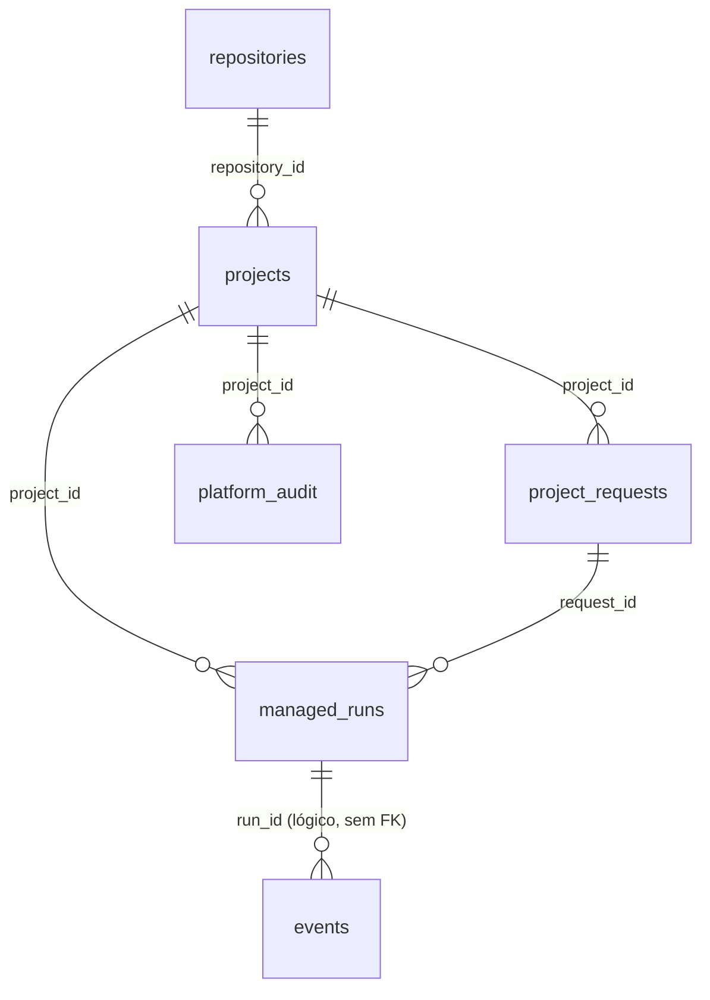
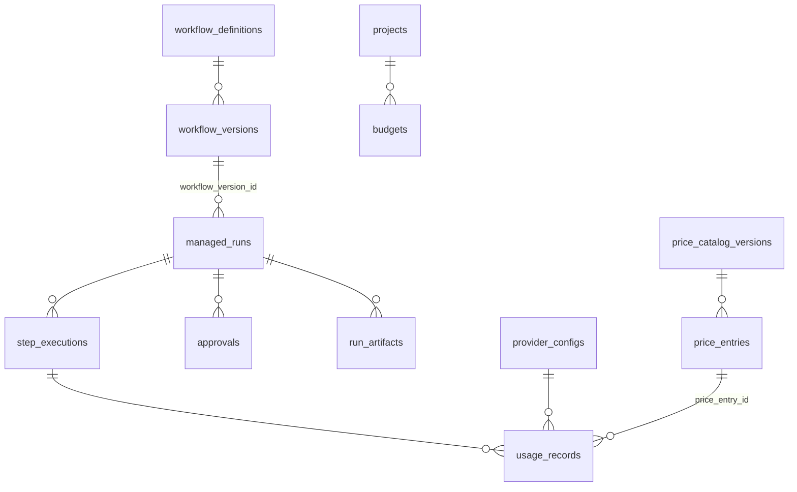

# Modelo de dados

## 1. Atual (migrações 1–4)

Ver [CURRENT_STATE_AUDIT.md §6](CURRENT_STATE_AUDIT.md#6-persistência-sqlite). Resumo:

`events.run_id` não tem chave estrangeira: runs legados do CLI só existem em `events`.

**CORE-004 (sem migração):** managed_runs.config mantém o formato plano legado por padrão. Configuração interna explícita pode incluir a chave JSON `bindings` (AgentBindings v1), coberta pelo mesmo digest e conferida contra os campos planos. O worker resolve snapshots antigos deterministicamente e passa bindings diretamente ao core, sem ler seleção/modelos do ambiente atual. Novos eventos started incluem bindings; State carrega o snapshot durante o run e retomada CLI. Isso não cria a coluna dedicada bindings/workflow_digest proposta para WF-002/WF-007 nem habilita retomada gerenciada.

**SEC-002 (sem migração):** managed_runs.config pode incluir environment_allowlist, mapa canônico de escopo→nomes explícitos de variáveis; só quando não vazio, coberto pelo digest. Valores nunca são copiados para esse campo. Configuração ausente mantém a forma/digest anteriores e snapshots antigos não recebem extensões novas do worker. O token interno de despacho existente continua nos descendentes para comprovar identidade de grupos, sem ser exposto pela API/eventos.

## 2. Migração 4 entregue e migrações 5+ propostas

Regras: migrações apenas **aditivas**; nenhuma coluna existente removida ou renomeada; `events` permanece fonte da timeline; cada migração tem número próprio em `platform_migrations` e teste de upgrade a partir de um banco v3.

### Migração 4 — workflows e providers (F2, implementada em V2-WF-002)

| Tabela | Colunas principais | Observação |
|---|---|---|
| `workflow_definitions` | `id`, `name`, `description`, `is_preset`, `created_at`, `archived_at` | Presets de sistema com `is_preset=1`, somente leitura |
| `workflow_versions` | `id`, `definition_id`, `version`, `schema_version`, `body` (JSON), `digest`, `created_at` | **Imutável**; editar cria nova versão |
| `provider_configs` | `id`, `kind` (`agent_runtime`/`model_provider`), `adapter`, `display_name`, `settings` (JSON sem segredo), `credential_ref`, `enabled` | `credential_ref` aponta para o keyring |
| `managed_runs` (+) | `workflow_version_id`, `bindings` (JSON), `workflow_digest` | Colunas novas, nulas para runs antigos |

**Entregue:** aplicação transacional em `project_store.connection()`, com rechecagem da versão sob lock de escrita. Upgrade v3 preserva linhas/índices/configuração/eventos; as três colunas novas são nulas para runs antigos. Banco novo/reabertura/aberturas concorrentes e rollback de DDL possuem testes contra fixture SQL v3 congelada.

- Tabelas novas começam vazias. `provider_configs.enabled` tem default 0; não há seed nem leitura dessas configurações pelo executor/registry nesta tarefa.
- `workflow_versions` tem unicidade `(definition_id, version)`, FK de definição, versões positivas e digest SHA-256 hexadecimal. Triggers recusam update/delete e substituição por conflito (`INSERT OR REPLACE`), inclusive com `recursive_triggers` desligado. Nova edição deve inserir nova versão.
- `managed_runs.workflow_version_id` possui FK e índice; `bindings` e `settings` exigem objeto JSON válido; digests são hexadecimais de 64 caracteres quando presentes. Demais colunas/constraints/índices legados não mudaram.
- SQLite com JSON1 é requerido pelas constraints (verificado localmente em 3.36.0). Constraints SQL validam estrutura básica; o futuro caminho de escrita deve validar `workflow_versions.body` com Pydantic antes de inserir e não persistir segredos em `settings`. Nenhum CRUD de workflow/provider, integração ao executor, keyring ou API foi criado em WF-002. `credential_ref` é apenas referência, anulável para CLI.
- Presets somente leitura e snapshots/digests de workflow em runs serão integrados em WF-004/WF-007; criar tabelas/colunas não ativa esses comportamentos.

**Integração WF-007 (sem nova migração):** append_version valida body via Pydantic e grava JSON canônico/digest SHA-256; snapshots explícitos incluem definição inteira, bindings e adapter/kind de provider_configs habilitados. managed_runs.config.workflow e as três colunas dedicadas são conferidos no runner antes de criar worktree. O digest de confirmação cobre config inteira; workflow_digest cobre o snapshot canônico. Corrida de configuração na reserva é recusada; alterações posteriores em definições/providers não são relidas pelo runner. Runs antigos/default sem seleção preservam colunas nulas/config/digest anteriores. Não há CRUD HTTP, seeds ou credenciais copiadas: settings não vazios/credential_ref e recursos ainda sem executor são recusados. Nenhum preset real é promovido automaticamente.

### Migração 5 — uso e custos (F3)

| Tabela | Colunas principais |
|---|---|
| `step_executions` | ver migração 6 (criada aqui se F3 vier antes) |
| `usage_records` | `id`, `run_id`, `step_execution_id`, `project_id`, `role`, `provider_config_id`, `adapter`, `model`, `call_index`, `started_at`, `duration_ms`, `input_tokens`, `output_tokens`, `cache_read_tokens`, `cache_write_tokens`, `reasoning_tokens`, `token_source`, `billing_mode`, `reported_cost_usd`, `estimated_cost_usd`, `price_entry_id`, `currency`, `error_kind`, `retry_of`, `raw_usage` (JSON redigido) |
| `price_catalog_versions` | `id`, `source` (`manual`/`openrouter_api`/…), `fetched_at`, `notes` |
| `price_entries` | `id`, `catalog_version_id`, `adapter`, `model`, `unit` (`per_1m_tokens`), `input_price`, `output_price`, `cache_read_price`, `cache_write_price`, `reasoning_price`, `currency`, `effective_from`, `effective_to` |
| `budgets` | `id`, `scope` (`project`/`run`/`global`), `scope_id`, `limit_usd`, `period` (`run`/`month`/`total`), `warn_ratio`, `action` (`warn`/`block`) |
| `budget_events` | `id`, `budget_id`, `run_id`, `kind` (`warn`/`block`/`override`), `at`, `details` |

### Migração 6 — resiliência (F4)

| Tabela | Colunas principais |
|---|---|
| `step_executions` | `id`, `run_id`, `node`, `task_id`, `attempt`, `role`, `idempotency_key` (`run_id:node:task:attempt`), `status` (`started`/`completed`/`failed`/`needs_inspection`/`skipped`), `side_effects` (`none`/`worktree_write`/`exec`), `git_head_before`, `tree_digest_before`, `tree_digest_after`, `started_at`, `finished_at`, `error` |
| `approvals` | `id`, `run_id`, `kind` (`plan`/`result`/`resume`/`budget_override`/`sensitive_action`), `status` (`pending`/`approved`/`rejected`), `requested_at`, `decided_at`, `decided_by`, `comment`, `subject_digest` |
| `run_artifacts` | `id`, `run_id`, `kind` (`plan`/`diff`/`test_report`/`review`/`handoff`), `path_or_blob`, `digest`, `created_at` |
| `managed_runs.status` | Novo valor `paused`/`awaiting_approval` exige recriar CHECK → **avaliar**: SQLite não altera CHECK; alternativa é coluna nova `phase` mantendo `status` compatível. Decisão em [PERSISTENCE.md](../specifications/PERSISTENCE.md) |

Checkpoints LangGraph ficam em **arquivo separado** (`<ORCH_DB>.checkpoints.db`) gerenciado por `langgraph-checkpoint-sqlite`, para isolar contenção de escrita e o esquema da biblioteca.

## 3. Regras de integridade

- Nenhuma coluna armazena segredo; `raw_usage` passa por redator antes de gravar.
- `usage_records.token_source` ∈ {`provider_reported`, `cli_reported`, `estimated`, `unavailable`}; `estimated_cost_usd` nulo quando não há preço.
- `workflow_versions.body` validado pelo schema da sua `schema_version` antes de inserir.
