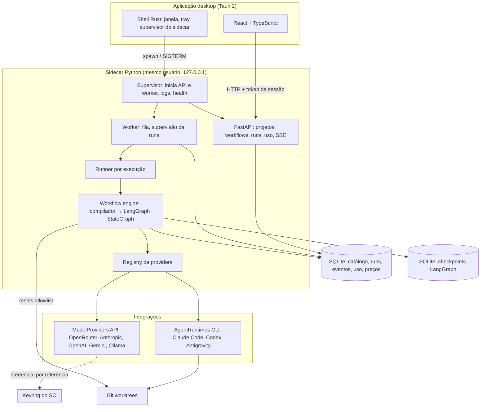

# System Overview — v2 (alvo)

Estado: **proposta**. O estado real está em [CURRENT_STATE_AUDIT.md](CURRENT_STATE_AUDIT.md).

## 1. Propósito

Aplicação local, desktop-first (Ubuntu), que coordena agentes de IA heterogêneos em workflows de desenvolvimento supervisionados: planejamento, implementação, testes, revisão, correção e documentação, com isolamento por Git worktree, contabilidade de uso e continuidade entre sessões e agentes.

## 2. Princípios

1. **Evoluir a v1** ([ADR-0001](DECISIONS/ADR-0001-evoluir-nao-reescrever.md)): o núcleo Python/LangGraph/SQLite, o worker separado e os contratos HTTP permanecem.
2. **Papel ≠ modelo**: um workflow descreve papéis e etapas; cada etapa é vinculada a um runtime/modelo por configuração ([ADR-0005](DECISIONS/ADR-0005-workflow-como-dado.md)).
3. **API model ≠ agente CLI** ([ADR-0004](DECISIONS/ADR-0004-model-provider-vs-agent-runtime.md)).
4. **Segurança por mecanismo, não por prompt** ([ADR-0009](DECISIONS/ADR-0009-seguranca-local.md)).
5. **Honestidade dos dados**: ausência de telemetria é registrada como `unavailable`, estimativa nunca é apresentada como cobrança ([ADR-0006](DECISIONS/ADR-0006-contabilidade-de-uso.md)).
6. **Nunca repetir efeitos colaterais às cegas** ([ADR-0007](DECISIONS/ADR-0007-checkpoints-e-idempotencia.md)).
7. **Contexto vive no repositório** ([ADR-0010](DECISIONS/ADR-0010-handoff-no-repositorio.md)).

## 3. Visão de contêineres

## 4. Fluxo de uma execução (alvo)

1. Usuário escolhe solicitação + workflow (preset ou customizado) na UI.
2. API valida workflow contra capacidades dos runtimes disponíveis, orçamento e política de segurança; congela snapshot (`workflow_version_id` + bindings + digest) em `managed_runs`.
3. Worker despacha runner; runner compila a definição em `StateGraph` com checkpointer SQLite.
4. Cada etapa chama `AgentRuntime.invoke()` ou `ModelProvider.generate()` através de um envelope comum que: registra `step_execution` (started), aplica permissões do papel, mede duração, coleta `UsageReport`, grava `usage_records` e evento, marca `completed`.
5. Gates (testes, aprovação de reviewer, orçamento, aprovação humana) decidem a próxima aresta.
6. Final: `ready_for_human_review`; handoff do run gerado deterministicamente a partir dos eventos.

## 5. O que não muda

- Fila durável em `managed_runs`, idempotência e digest de confirmação.
- Uma worktree por run; sem merge/push/deploy.
- Tabela `events` e contratos `/runs*`.
- CLI `orchestrator.cli` continua funcionando (com preset legado).

## 6. Documentos relacionados

[COMPONENTS.md](COMPONENTS.md) · [DATA_MODEL.md](DATA_MODEL.md) · [especificações](../specifications/) · [ROADMAP](../planning/ROADMAP.md)
