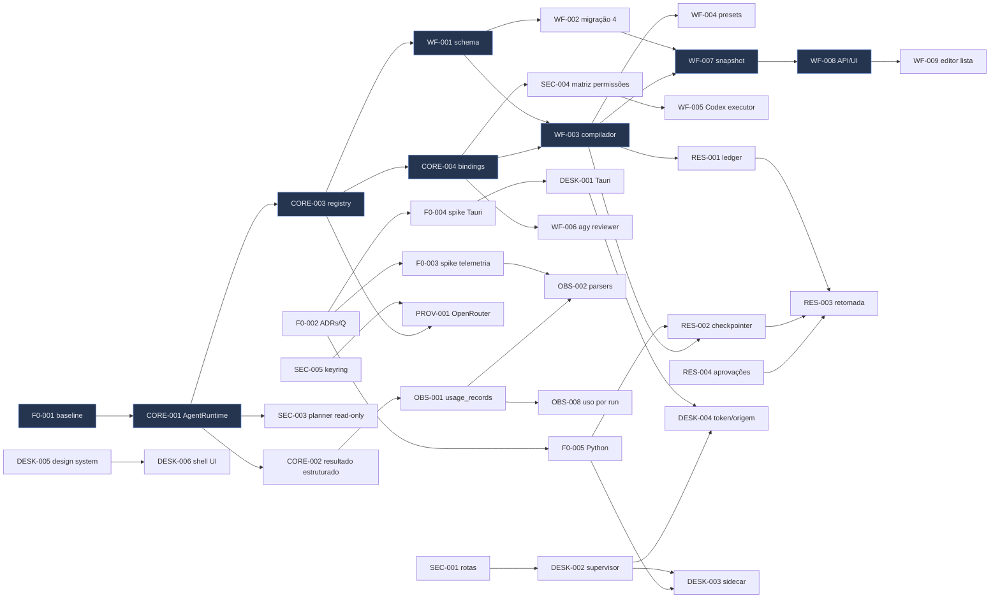

# Dependências

## 1. Grafo de tarefas (caminho crítico do MVP em destaque)

Tarefas sem dependência que podem começar em paralelo a qualquer momento após F0-001: `SEC-001`, `SEC-002`, `SEC-006`, `DESK-005`, `DIST-002`, `DOC-001`.

## 2. Dependências externas

| Dependência | Uso | Estado | Risco |
|---|---|---|---|
| Python 3.9 (atual) → 3.11+? | Backend, empacotamento | 3.9.7 instalado, EOL out/2025 | Libs novas podem exigir ≥3.10 (Q3) |
| LangGraph 0.6.11 (`<2` em requirements) | Engine | Instalado | Migração para 1.x pode exigir ajustes |
| `langgraph-checkpoint-sqlite` | Checkpoints | Não instalado | Compatibilidade a verificar |
| `keyring` + libsecret/Secret Service | Credenciais | Não instalado | Sem D-Bus em headless |
| Tauri 2 CLI + `libwebkit2gtk-4.1-dev` | Desktop | Rust presente; Tauri ausente | WebKitGTK |
| PyInstaller (ou alternativa) | Sidecar | Não instalado | Tamanho/tempo de start |
| `@xyflow/react` | Grafo/editor | Não instalado | Performance em WebKitGTK |
| xterm.js (opcional) | Terminal | Não instalado | Pode ser substituído por lista virtualizada |
| Claude Code 2.1.92, Codex 0.166.0, agy 1.5.1 | Runtimes | Instalados | Formatos de saída mudam entre versões |
| OpenRouter API | ModelProvider | — | Rede, rate limits, mudanças de API |
| Ollama | ModelProvider local | Instalado | F6 |

Nenhuma dependência foi instalada nesta sessão.
