# Roadmap v2

A ordem original proposta (núcleo → workflows → observabilidade → desktop → resiliência → distribuição) foi **revisada** após a auditoria:

| Mudança | Motivo |
|---|---|
| Baseline de segurança entra na F1 | Rotas sem Host check e ambiente herdado são pré-requisitos do desktop e de chaves de API |
| OpenRouter básico sobe para F2 | É a prova mais barata da separação ModelProvider/AgentRuntime; catálogo completo fica na F6 |
| Resiliência (F4) antes do desktop (F5) | Fechar o app interrompe runs; retomada segura reduz o dano |
| Captura de uso começa na F1 (`agent_call`) | Sem custo extra quando os adapters são extraídos |

## Fases

| Fase | Objetivo | Entregas principais | Saída (gate) |
|---|---|---|---|
| **F0** Auditoria e arquitetura | Mapear v1, decidir | Docs, ADRs, spikes (telemetria, Tauri, Python) | ADRs aceitos; OPEN_QUESTIONS P0 respondidas |
| **F1** Núcleo extensível + segurança | Adapters atrás de interfaces, sem regressão | CORE-001..004, SEC-001/002/003/006 | Suíte atual verde; argv idêntico no `legacy-v1` |
| **F2** Workflows configuráveis | Papel ≠ modelo | WF-001..010, PROV-001, SEC-004/005 | Presets A/B/C executam com fakes; snapshot por run |
| **F3** Observabilidade | Uso e custo honestos | OBS-001..008 | Uso por chamada com fonte; dashboard |
| **F4** Resiliência | Retomar sem duplicar efeitos | RES-001..006, DOC-002 | Crash injection passa |
| **F5** Desktop | App sem terminal | DESK-001..010 | .deb instala e roda em Ubuntu limpo |
| **F6** Distribuição e integrações | Publicar e ampliar | DIST-*, PROV-002/003, WF-011/012, SEC-008 | Pacotes em CI; e2e |

```mermaid
gantt
    dateFormat X
    axisFormat %s
    section Sequência (relativa, sem datas)
    F0 :f0, 0, 1
    F1 :f1, after f0, 2
    F2 :f2, after f1, 3
    F3 :f3, after f1, 2
    F4 :f4, after f2, 2
    F5 (design system pode começar após F0) :f5, after f2, 3
    F6 :f6, after f5, 2
```

Barras indicam ordem e paralelismo possível, **não duração**. F3 pode correr em paralelo com F2 após CORE-002; DESK-005 (design system) pode começar logo após F0.

## MVP v2

**Essencial**
1. Adapters atrás de `AgentRuntime` com manifesto e evento `agent_call` (F1).
2. Baseline de segurança: todas as rotas protegidas, env allowlist, Planner read-only, hooks Git desativados (F1).
3. Workflow persistido/validado/compilado; presets `legacy-v1`, A, C; B com OpenRouter básico (F2).
4. Snapshot de workflow por run; seleção de workflow na UI; editor em lista (F2).
5. `usage_records` com fonte explícita + uso por run na tela de detalhes (F3 parcial).
6. App Tauri no Ubuntu que inicia/encerra o backend, com sidebar de projetos e design system base (F5 parcial: DESK-001..006).
7. Protocolo de handoff no repositório (entregue em F0).

**Melhorias futuras**
Dashboard de custos completo e orçamentos com bloqueio, retomada gerenciada, SSE/terminal, grafo React Flow, editor visual, OpenRouter catálogo completo, Ollama, AppImage/.deb em CI, Windows/macOS, isolamento de SO, ramificações de workflow.

## Premissas
- Um desenvolvedor/agente por vez no repositório; tarefas pequenas e revisadas por agente diferente.
- Nenhuma tarefa consome quota real sem autorização explícita.
- Complexidades em [BACKLOG.md](BACKLOG.md) são relativas; não há estimativa em horas.
