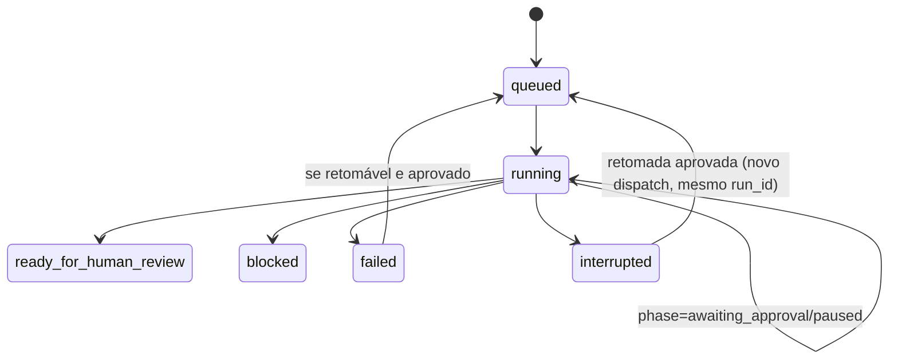

# TASK 05 — Persistência, recuperação e continuidade

## 1. Identificador e título
`V2-T05` — Checkpoints, ledger e retomada. Subtarefas `V2-RES-001..006`.

## 2. Objetivo
Interromper e retomar execuções sem perda de contexto nem repetição cega de efeitos colaterais ([ADR-0007](../architecture/DECISIONS/ADR-0007-checkpoints-e-idempotencia.md)).

## 3. Estado atual comprovado
`managed_runs` com lifecycle e reconciliação de órfãos; `events` append-only; `resume` só para runs legados do CLI; runs gerenciados interrompidos ficam `interrupted` sem retomada; não há registro de chamada iniciada; sem aprovação humana persistida.

## 4. Requisitos funcionais
Cada execução possui (✓ = já existe):

| Item | Hoje | v2 |
|---|---|---|
| ID único | ✓ `run_id` | — |
| Projeto | ✓ `project_id` | — |
| Workflow | ✗ (config env) | `workflow_version_id`, `bindings`, `workflow_digest` |
| Config de modelos | parcial (`config`) | bindings |
| Etapa atual | derivada de eventos | `step_executions` + checkpoint |
| Histórico de eventos | ✓ `events` | `step_id` nos payloads |
| Artefatos | caminho da worktree | `run_artifacts` (plano, diff, relatório de teste, revisão, handoff) |
| Estado dos testes | em payload `review` | artefato `test_report` + coluna resumida |
| Custos/tokens | ✗ | `usage_records` |
| Erros | ✓ `error` | + `step_executions.error` |
| Checkpoints | ✗ | SqliteSaver |
| Aprovação humana | ✗ | `approvals` |

- RF1 Retomar run `interrupted`/`failed` (retomável) a partir do último checkpoint, com confirmação humana.
- RF2 Detecção de passo parcial e decisão humana (aceitar/repetir/abortar).
- RF3 Aprovação humana opcional após plano e obrigatória antes de retomar.
- RF4 Pausa solicitada pelo usuário entre etapas (não no meio de uma chamada).
- RF5 SSE para eventos e estados (substitui polling progressivamente).

## 5. Requisitos não funcionais
- RNF1 Nunca reexecutar um nó com `side_effects≠none` cujo ledger esteja `started` sem decisão humana.
- RNF2 Recuperação após crash do app: worker reconcilia (já existe) + marca `step_executions` abertos como `needs_inspection`.
- RNF3 Checkpoint DB separado; corrupção do checkpoint não corrompe catálogo.
- RNF4 Migração de status sem quebrar o CHECK atual de `managed_runs.status`.

## 6. Arquitetura proposta

### 6.1 Estados
Manter `status` atual (compat). Adicionar coluna `phase` (`null` | `paused` | `awaiting_approval` | `resuming`) e valores lógicos derivados na API. Alternativa (recriar tabela para mudar CHECK) rejeitada no MVP por risco de migração.



### 6.2 Envelope de nó
```
ledger.start(run, node, task, attempt, side_effects, git_head, tree_digest)
  → invoke runtime/provider
  → artifacts + usage + event
ledger.complete(..., tree_digest_after)
checkpoint (automático LangGraph após o nó)
```
`tree_digest` = hash de `git status --porcelain=v2` + `git diff HEAD` + conteúdo de não rastreados (limitado), calculado pelo orquestrador.

### 6.3 Algoritmo de retomada
1. Carregar último checkpoint (`thread_id=run_id`).
2. Para cada `step_execution` `started` sem `completed`: comparar digest atual com `before`.
   - igual → proposta "repetir passo" (sem efeito visível ocorreu).
   - diferente → proposta "aceitar estado e seguir para review" ou "abortar"; descarte de alterações só com comando explícito do usuário e confirmação extra.
3. Criar `approval(kind=resume)`; após aprovação, re-enfileirar com o mesmo `run_id` e nova `dispatch_token`; worker reserva repositório pelo índice existente.
4. Testes e reviewer `read_only` podem ser repetidos sem pergunta.

### 6.4 Idempotência
- Chave `run_id:step_id:task_id:attempt` única em `step_executions`.
- Início HTTP já idempotente (`idempotency_key`) — manter.
- Escritas de uso/evento dentro da mesma transação de `ledger.complete`.

### 6.5 Compatibilidade Python
`langgraph-checkpoint-sqlite` — compatibilidade de `SqliteSaver` verificada e testada com Python 3.12 e LangGraph em `V2-F0-005` (`tests/test_python_checkpoint_compat.py`), desbloqueando `V2-RES-002`.

## 7. Componentes afetados
`core.py`/compilador, `execution_runner.py`, `worker.py` (reconcile + redispatch), `execution_manager.py`, `api.py`, frontend Details.

## 8. Arquivos previstos
`orchestrator/resilience/{ledger,checkpointer,recovery,digest}.py`, `orchestrator/approvals.py`, migração 6, `tests/resilience/test_{ledger,resume_partial,crash_recovery}.py`, `frontend/src/features/Approvals.tsx`.

## 9. Dependências
`V2-WF-003` (nós gerados pelo compilador), `V2-F0-005`.

## 10. Riscos
| Risco | Mitigação |
|---|---|
| Estado LangGraph não serializável | `State` só com JSON; teste de round-trip |
| Digest caro em repositórios grandes | Limites + `git` nativo; medir |
| Usuário retoma sobre worktree modificada manualmente | Digest detecta; decisão explícita |

## 11. Critérios de aceite verificáveis
- CA1 Matar o runner (SIGKILL) durante implementação mockada → worker marca `interrupted`, ledger `needs_inspection`; retomada aprovada continua sem chamar novamente o implementador se o usuário escolher "aceitar estado".
- CA2 Retomada nunca ocorre sem `approval` aprovado (teste).
- CA3 Banco v3 migra para v6 preservando todos os runs e eventos (teste de upgrade).
- CA4 SSE entrega eventos na ordem de `events.id` com reconexão por `Last-Event-ID`.

## 12. Testes necessários
Crash injection com subprocesso real e agentes mockados (padrão de `tests/test_execution_manager.py`), upgrade de esquema, round-trip de checkpoint, SSE.

## 13. Complexidade
RES-001: M · RES-002: M · RES-003: L · RES-004: M · RES-005: S · RES-006: M.

## 14. Prioridade
P1 (RES-001..004) · P2 (RES-005, 006).

## 15. Perfil recomendado
Backend Python com experiência em concorrência/processos; revisão por segundo agente obrigatória (RES-003).
